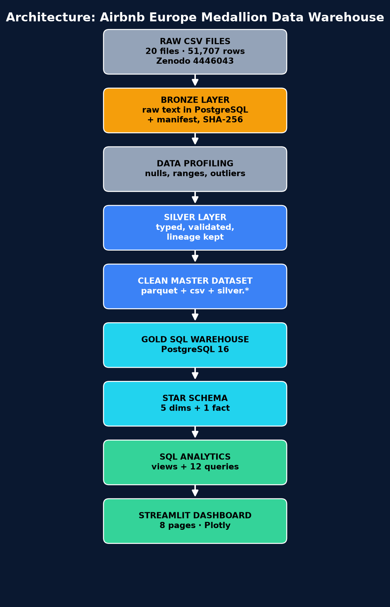
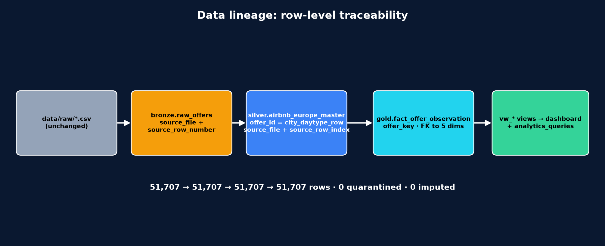
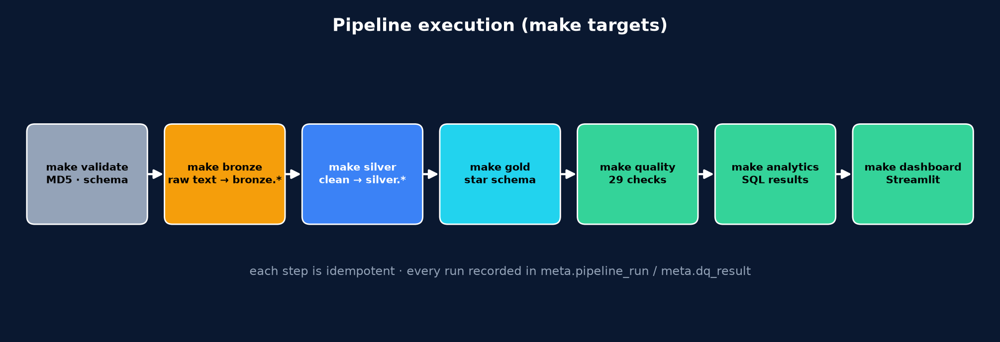
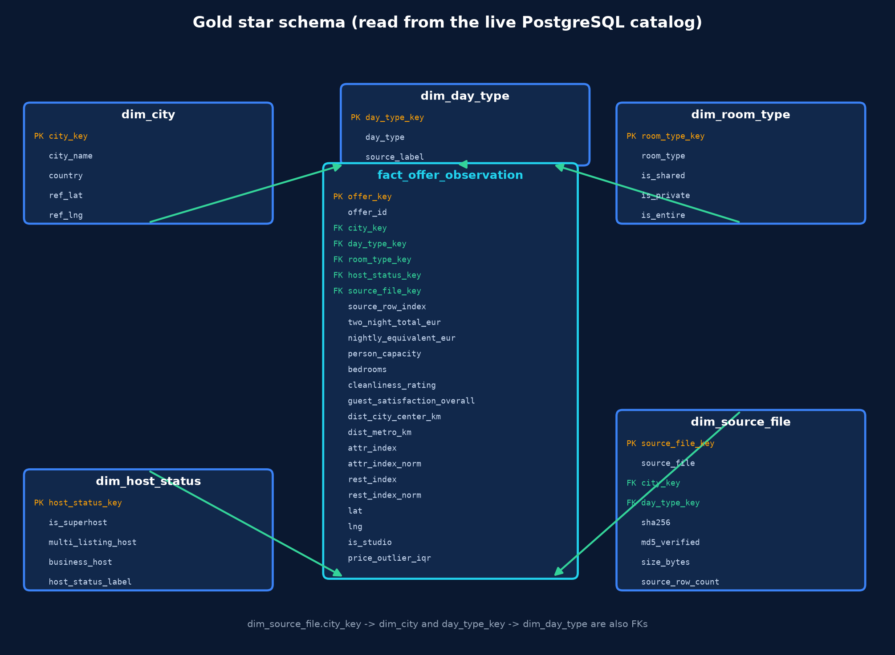

# Architecture
  

## Engine
PostgreSQL 16.2 (binaries from the `pgserver` pip package, so no system install or Docker is needed; Homebrew's PostgreSQL 14 on the build machine was broken: missing ICU library). Local cluster in `.pgdata/`, loopback only, trust auth, **no password stored anywhere**; override with `AIRBNB_DWH_URL`.
Schemas: `bronze`, `silver`, `gold`, `gold_ref` (reference), `meta` (pipeline run log + DQ results; survives Gold rebuilds).

## Idempotency
* Bronze: per-file SHA-256 in `bronze.ingestion_log` (UNIQUE) → unchanged files skipped, changed files replaced, same content under another name rejected.
* Silver: full refresh of `silver.airbnb_europe_master` (TRUNCATE + COPY).
* Gold: `DROP SCHEMA gold CASCADE` and rebuild; surrogate keys use `row_number() OVER (ORDER BY natural key)` so keys are identical across rebuilds (tested).

## Star schema (grain: one offer observation = one row of one source CSV)
Dimensions: `dim_city` (10), `dim_day_type` (2), `dim_room_type` (3), `dim_host_status` (6 observed combinations of superhost × multi × biz), `dim_source_file` (20, with SHA-256, size, row count). Fact: `fact_offer_observation` with 5 FKs, degenerate `offer_id`/`source_row_index`, measures (two-night total, nightly equivalent, capacity, bedrooms, ratings, distances, indices, lat/lng) and flags.

### Why the suggested Date / Host / Property dimensions are absent
Verified in `docs/DATA_PROFILING.md`: the CSVs contain no calendar date, no host id, no listing id and no property type. Creating them would require fabrication. `dim_host_status` (host-portfolio flags) and `dim_room_type` are the supportable substitutes; `dim_day_type` captures the only temporal attribute (weekday/weekend sample).

## Dashboard security
Read-only DB session (`default_transaction_read_only=on`, 30 s statement timeout), filter values bound as parameters, explorer accepts only keys of whitelisted metric/grouping dictionaries, predefined queries come from a fixed repository folder, no credentials in code.
