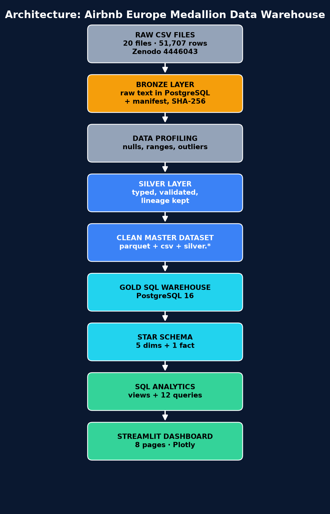
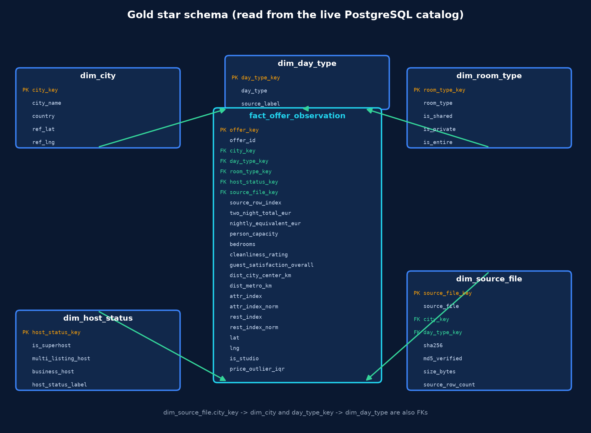
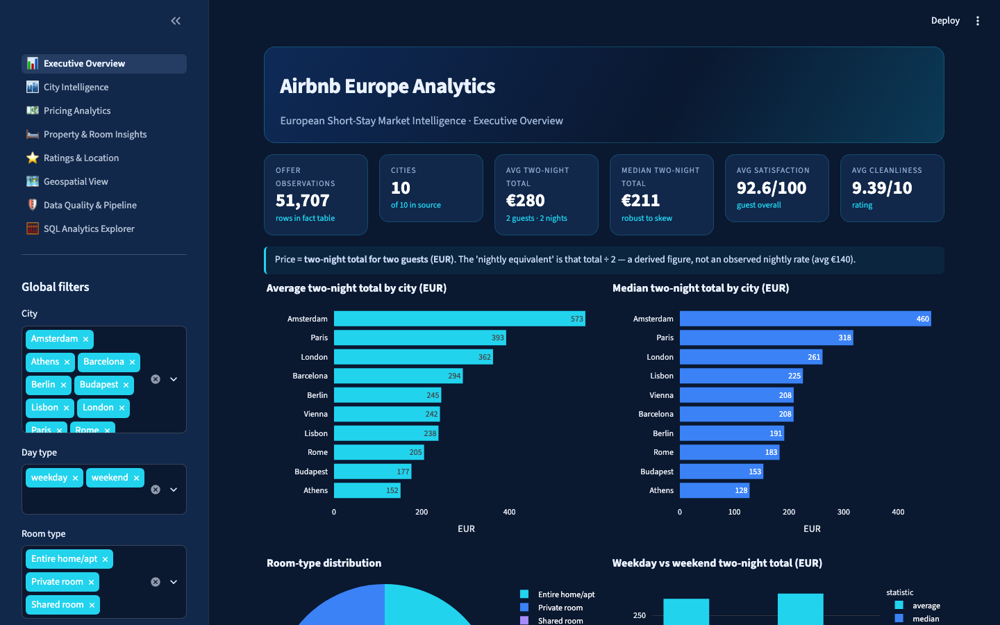
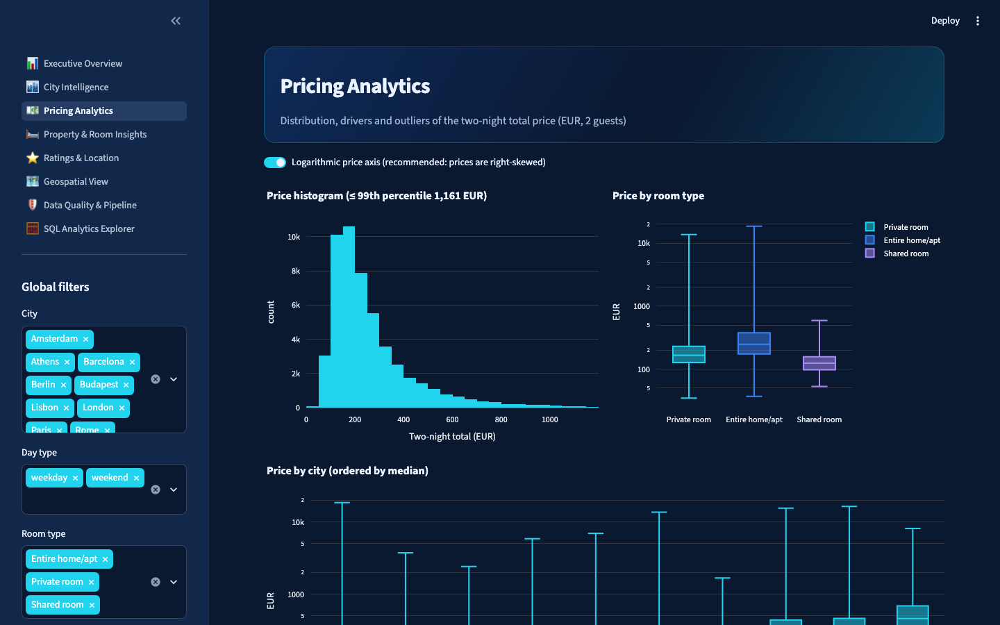
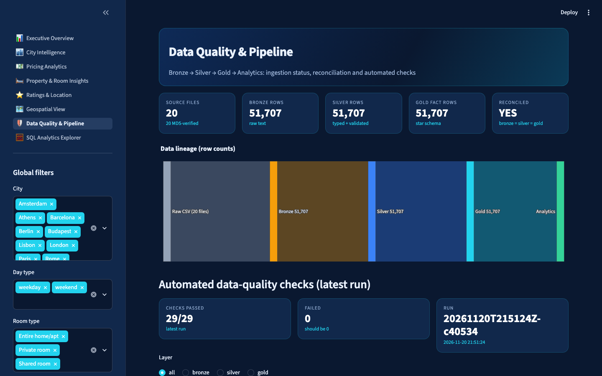
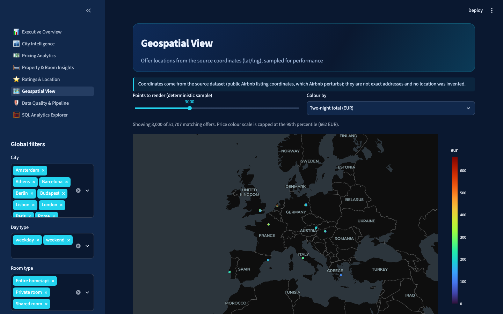

# Airbnb Europe Analytics
**Medallion Data Warehouse & Interactive Analytics Platform** · INSTANT AI & Data Science Training · Sprint 1 (Data Analysis)
Owner: Faris Mohamed Kishtah (`fariskishtah`)

An end-to-end, reproducible Data Warehouse for the official Sprint 1 project **"Airbnb Prices in European Cities"**:
raw CSVs → **Bronze** → **Silver** → **Gold star schema in PostgreSQL** → SQL analytics → **Streamlit + Plotly dashboard**.

> ### ⚠️ Power BI substitution disclosure
> The original assignment requests a Power BI `.pbix` report. **This submission instead provides a working SQL-connected
> Streamlit + Plotly dashboard. No `.pbix` file is included.** The original `.pbix` requirement is **not satisfied**; see
> [`4_powerbi_dashboard/POWER_BI_NOT_INCLUDED.md`](4_powerbi_dashboard/POWER_BI_NOT_INCLUDED.md) and [`REQUIREMENTS_COMPLIANCE.md`](REQUIREMENTS_COMPLIANCE.md).

## Dataset and provenance
Gyodi & Nawaro, *Determinants of Airbnb prices in European cities* (supplementary material), Zenodo v2,
DOI [10.5281/zenodo.4446043](https://doi.org/10.5281/zenodo.4446043), **CC BY 4.0**. 20 CSV files (10 cities × weekday/weekend),
**51,707 rows**, 20 columns each (1 unnamed exported index + 19 analytical). All 20 files were re-verified against Zenodo's published MD5s.
`realSum` is the **full price for two people and two nights in EUR** (Zenodo column description) – *not* a nightly price.
We derive `nightly_equivalent_eur = realSum / 2` and label it as a derived equivalent only.

## Architecture


| Layer | What it does | Where |
|---|---|---|
| Bronze | Validates files (schema, MD5, SHA-256), writes manifest, loads **raw text** to `bronze.raw_offers` idempotently | `1_bronze_layer/`, `airbnb_dwh/bronze.py` |
| Silver | Typed + validated master dataset with lineage; invalid rows are quarantined, nothing imputed | `2_silver_layer/`, `airbnb_dwh/silver.py`, `data/silver/` |
| Gold | PostgreSQL star schema, constraints, indexes, views, 12 analytical queries, 29 data-quality checks | `3_gold_layer/` |
| Dashboard | 8-page Streamlit + Plotly app reading live from Gold (read-only, parameterised SQL) | `4_web_dashboard/` |

### Star schema (grain: one offer observation = one row of one source CSV)


`dim_city`, `dim_day_type`, `dim_room_type`, `dim_host_status`, `dim_source_file` → `fact_offer_observation` (51,707 rows).
**Not implemented because the source cannot support them:** Date dimension (no calendar date), Host dimension (no host id),
Property-type dimension (no property type; only room type). Nothing was fabricated. Details in `ARCHITECTURE.md`.

## Reproduce
```bash
make setup db-start       # venv + venv-bundled PostgreSQL 16 on 127.0.0.1:54329 (no password, loopback only)
make all                  # validate, bronze, profile, silver, gold, quality, analytics, numeric validation, tests
make dashboard            # http://localhost:8501
```
See [`HOW_TO_RUN.md`](HOW_TO_RUN.md). Every step is idempotent; reruns do not duplicate data.

## Dashboard
Pages: Executive Overview · City Intelligence · Pricing Analytics · Property & Room Insights · Ratings & Location ·
Geospatial View · Data Quality & Pipeline · SQL Analytics Explorer (whitelisted metrics × groupings, no free-form SQL).
Global filters (city, day type, room type, superhost, price range, capacity) rewrite the SQL; CSV export on every table.

| Overview | Pricing |
|---|---|
|  |  |
| **Data quality & lineage** | **Geospatial** |
|  |  |

## Testing & validation (actual results)
* `pytest`: **52 passed, 0 failed, 0 skipped** (bronze, silver, gold, dashboard incl. Streamlit AppTest for every page, security). Integration tests rebuild the whole pipeline into a separate PostgreSQL test database.
* Data quality: **29/29 checks pass** (`artifacts/reports/data_quality_report.json`).
* Numeric validation: 42 KPI comparisons across Silver (pandas) ↔ Gold (SQL) ↔ dashboard queries, **0 mismatches**, identical city ranking (`artifacts/reports/numeric_validation.md`).
* Real-browser verification (Playwright/Chromium): all 8 pages desktop, 2 pages mobile, filter and CSV-download interaction, 0 Streamlit exceptions, 0 console errors (`artifacts/reports/browser_verification.json`).

## Key findings (descriptive; observational data, no causal claims)
* Highest average two-night total: **Amsterdam €573** (median €460); lowest: **Athens €152** (median €128).
* Entire homes average €324 vs private rooms €205 vs shared rooms €144.
* Prices are right-skewed (median €211 vs mean €280; max €18,545) → medians reported alongside means.
* Weekend vs weekday average differs most in Amsterdam (+11.0%) and Budapest (+9.9%); Athens (−5.3%) and Paris (−3.0%) are lower on weekends. *Weekday and weekend are separate samples, not the same listings.*
* Strongest correlations with price: attraction index (0.29), bedrooms (0.22), capacity (0.20); distance to centre is weak (−0.05); satisfaction and cleanliness ≈ 0. Correlation ≠ causation.
* Superhost offers average lower prices (€254 vs €289) but have higher satisfaction (96.9 vs 91.2); superhosts differ in city/room mix, so this is not an effect estimate.

## Limitations
No calendar date → no time series or seasonality; no listing/host id → no listing-level or host-level analysis, repeated listings cannot be detected;
`multi`/`biz` are host-portfolio-size flags; coordinates are Airbnb-perturbed; 2020-era snapshot; `country` in `dim_city` and the coordinate sanity check use a small hand-written reference table (public knowledge), not the Airbnb data.
**External enrichment/scraping was deliberately not performed** – see `docs/ENRICHMENT_DECISION.md`.

## Links
GitHub: https://github.com/fariskishtah/airbnb-europe-dwh · LinkedIn: PENDING · Facebook: PENDING
